# AC EVO Overlay

Portable telemetry HUD for Assetto Corsa EVO on Windows.

[Download a release](https://github.com/blueratdota/ace-overlay/releases) · [Latest Windows builds](https://github.com/blueratdota/ace-overlay/actions/workflows/build.yml)

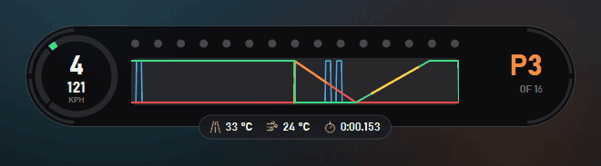

## Features

- **Inputs HUD** — Gear, speed, position, throttle and brake ring, adjustable pedal history, configurable RPM lights, and side-aware TC and ABS indicators inferred from wheel slip, plus track, air temperature and lap time.
- **Engine and hybrid** — Power and torque, or battery charge, power, deployment and recovery on hybrids.
- **Info panel** — Live lap delta and prediction, lap validity, fuel use and finish estimate, warm and garage tyre pressures, electronics, temperatures and nearby gaps.
- **Standings** — Order, gaps, best and last laps, fastest-lap highlight and pit tags. Three layouts, adjustable row count and manufacturer badges from the local game installation when available. The optional bridge adds driver names, car models and game timing. Without it, standings are estimated from car positions after the overlay learns the track.
- **Controls** — Pinnable, click-through windows with saved positions, individual visibility toggles, HUD scaling and an optional driving-only mode.

## Quick start

1. Download and extract the Windows ZIP. Keep its files together and run **ace-overlay.exe**.
2. Set AC EVO to **Borderless** or **Windowed**. Use each panel's pin to move it, and the gear or tray menu for settings.
3. Optional game leaderboard setup. Run **Setup standings.bat**, restart AC EVO and enable **ACE Standings Bridge** in the game's right-edge HUD drawer. The included [ACE UI App Loader](https://github.com/dreasgrech/ACEUIAppLoader) targets AC EVO `0.9.1+release.6`. For other builds, install a matching loader first.

## Screenshots

Captured with simulated telemetry.

| | |
| --- | --- |
| 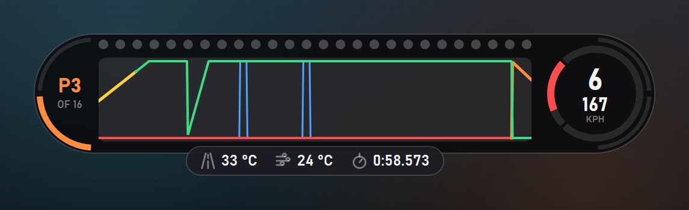 **ABS under braking** | 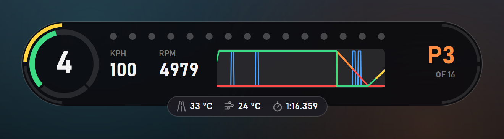 **TC on exit** |
| 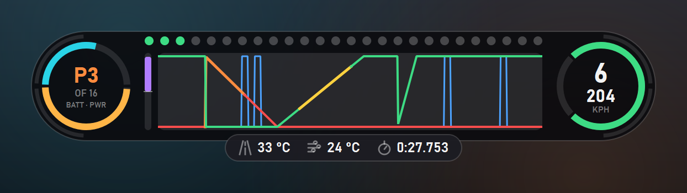 **Hybrid deployment** | 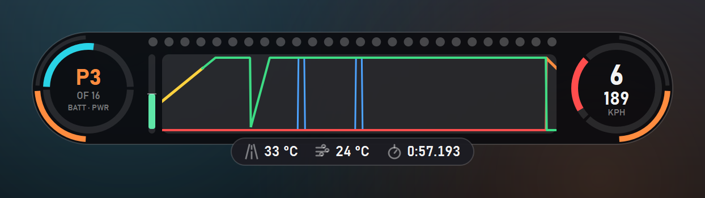 **Hybrid recovery** |
| 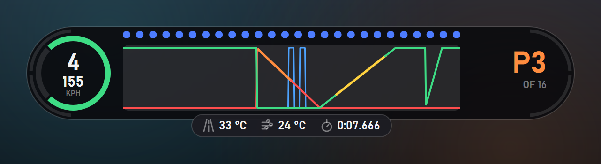 **Shift flash** | 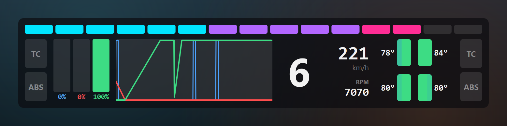 **Custom RPM colours** |
| 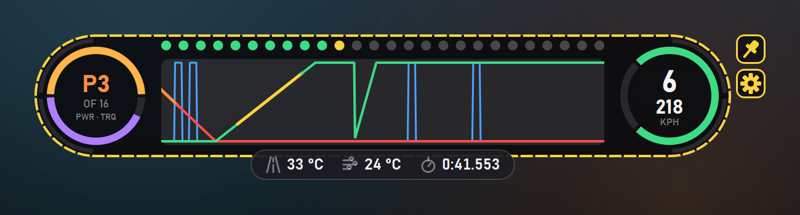 **Move mode** | 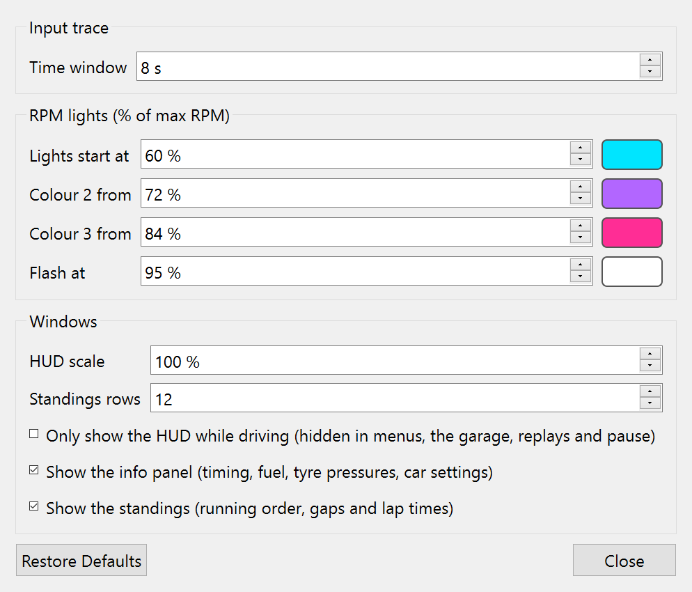 **Settings** |
| 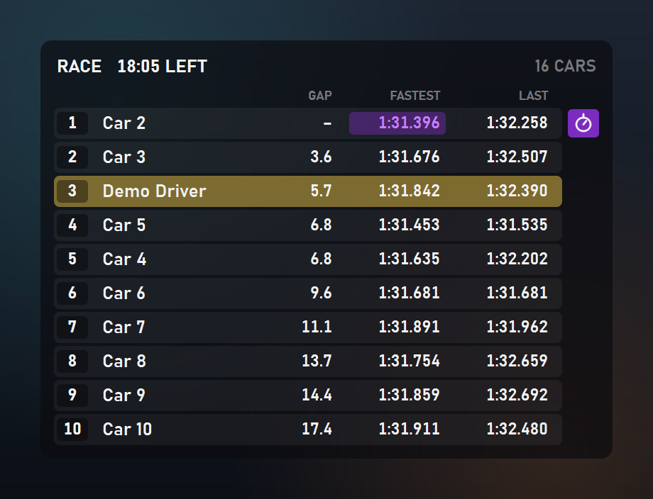 **Standings** | 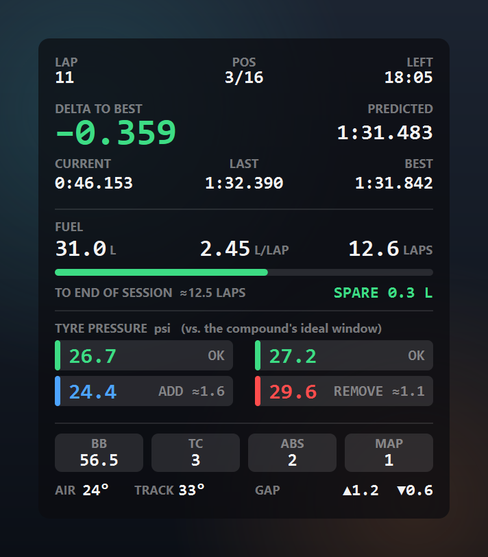 **Info panel** |

[MIT License](LICENSE) · Independent community project.
