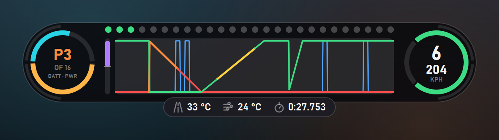
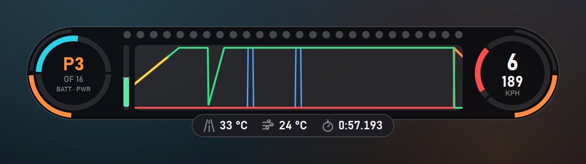

<h1 align="center">AC EVO Overlay</h1>

<p align="center">
  <strong>A lightweight, real-time telemetry HUD for Assetto Corsa EVO.</strong><br>
  A compact dash with your pedals, gear, shift lights, input trace, TC/ABS and battery, plus an info
  panel for timing, fuel and tyre pressures, drawn on top of the game.
</p>

<p align="center">
  <a href="https://github.com/blueratdota/ace-overlay/actions/workflows/build.yml"></a>
  
  
  
  <a href="LICENSE"></a>
</p>

<p align="center">
  
  <br><sub>One demo lap: flat out with the shift lights, heavy braking with ABS, and TC on the exit.</sub>
</p>

<p align="center">
  <a href="#-get-the-app-no-python-needed">Get the app</a> ·
  <a href="#features">Features</a> ·
  <a href="#screenshots">Screenshots</a> ·
  <a href="#using-the-overlay">Using it</a> ·
  <a href="#how-it-works">How it works</a> ·
  <a href="#development">Development</a>
</p>

---

## 🚀 Get the app (no Python needed)

The app is a portable Windows program: a folder with `ace-overlay.exe` in it. There's nothing to
install and you don't need Python. GitHub builds the program for you from this repository.

### Option 1: Download a release (easiest)

1. Go to the **[Releases page](https://github.com/blueratdota/ace-overlay/releases/latest)**.
2. Under **Assets**, download `ace-overlay-<version>-win64.zip`.
3. Continue with [Install and run](#install-and-run).

> If the Releases page says there aren't any releases yet, use Option 2. It gets you the same
> program.

### Option 2: Download GitHub's latest automatic build

GitHub rebuilds the program every time the code changes. You need a free GitHub account to download
these builds.

1. **Sign in** to [github.com](https://github.com/login) (or create a free account).
2. Open the **[Build portable package](https://github.com/blueratdota/ace-overlay/actions/workflows/build.yml)**
   page (the repository's **Actions** tab → *Build portable package*).
3. Click the **newest run with a green check mark** ✅.
4. Scroll down to **Artifacts** and click **`ace-overlay-win64`**. Your browser downloads
   `ace-overlay-win64.zip`.
5. Continue with [Install and run](#install-and-run).

<details>
<summary><b>No green run, or the download has expired?</b> Build it yourself on GitHub in about 5 minutes.</summary>

<br>

GitHub keeps automatic builds for 90 days. To make a fresh one, run the build in your own copy of
the repository. It runs on GitHub's computers, not yours:

1. At the top-right of this repository, click **Fork** → **Create fork**.
2. In your fork, open the **Actions** tab. If GitHub asks, click **"I understand my workflows, go
   ahead and enable them"**.
3. In the list on the left, click **Build portable package**.
4. Click **Run workflow** (right side) → **Run workflow**.
5. Wait about 5 minutes until the run shows a green check mark ✅, then click it.
6. Under **Artifacts**, click **`ace-overlay-win64`** to download it.

</details>

### Install and run

1. **Extract** the downloaded zip into its own folder, for example `Documents\AC EVO Overlay`.
   Keep all the files together: the `_internal` folder must stay next to `ace-overlay.exe`.
2. In **Assetto Corsa EVO**, set the display mode to **Borderless** (or Windowed) in the video
   settings. No overlay can draw over exclusive fullscreen, and VR isn't supported.
3. Double-click **`ace-overlay.exe`**. It shows *Waiting for Assetto Corsa EVO…* until you're in a
   session. You can start it before or after the game.
4. **Position it:** click the 📌 pin next to the HUD, drag the HUD where you want it, and click the
   pin again to lock it. Do the same for the info panel.
5. **Adjust it:** click the ⚙️ gear under the pin for settings: HUD scale, shift-light colours,
   trace length, and showing the HUD only while driving.

> **"Windows protected your PC"?** The program isn't code-signed, so Windows SmartScreen warns about
> it the first time. Click **More info** → **Run anyway**. Some antivirus tools also flag unsigned
> programs built this way. That's a false positive.

**Quit** from the green tray icon (bottom-right of the taskbar, possibly under the ^ arrow). **To
update**, download a newer build and extract it over the same folder. Your settings and positions
(`settings.ini`) are kept.

---

## Features

**The HUD**, a compact pill-shaped dash:

- **Pedal ring.** The gear and speed sit inside a ring at the right end. Throttle fills three
  quarters of it in green, and brake fills the left quarter in red.
- **Shift lights.** 26 dots along the top edge, with your own colour zones and flash point. They're
  also the RPM display.
- **Real-time input trace.** Throttle, brake and clutch history. The right edge is always the live
  input, and the time window is adjustable (2–30 s). The brake line turns orange while ABS works, and
  the throttle line yellow while TC cuts.
- **Side-aware TC and ABS.** The pill's rounded ends are thin lines: upper quarter TC (yellow), lower
  quarter ABS (orange). The left end is the car's left wheels and the right end its right wheels, so
  you can see which side is slipping.
- **Energy ring and position.** The left end holds your position ("P19 of 20") inside a second ring.
  On hybrids it shows battery charge (top) and engine power (bottom); on other cars, power (top) and
  torque (bottom), against the car's highest values this session.
- **Battery flow bar (hybrids).** A thin bar left of the trace that grows up in purple while the
  battery deploys and down in green while it recovers energy.
- **Track, air and lap time.** A chip under the dash.
- **HUD scale.** 50–250 %, and it stays sharp at any size.
- **Only while driving (optional).** Hides the HUD in menus, the garage, replays and pause.

**The info panel**, a separate window:

- **Timing:** live delta to your best lap, predicted, current, last and best laps, and an INVALID
  tag.
- **Fuel:** litres left, use per lap, laps of fuel left, and fuel needed (or spare) to the end of the
  session.
- **Tyre pressures:** judged at the tyre's ideal temperature. It shows the pressure each tyre will
  run when warm and the garage pressure to set. Ideal windows are learned per tyre compound.
- **Car:** brake bias, TC, ABS and engine map settings, air and track temperature, and gaps ahead
  and behind.

**Out of the way:** always on top and click-through, so the mouse goes straight to the game. Pin both
windows anywhere. It's portable: no installer, no game files touched, and settings are saved next to
the program.

## Screenshots

<table>
  <tr>
    <td width="50%">
      
      <p align="center"><sub><b>Trail braking into a left-hander.</b> The ring's red quarter shows the brake, and only the left ABS line lights up, where the unloaded inside wheels lock first.</sub></p>
    </td>
    <td width="50%">
      
      <p align="center"><sub><b>Corner exit.</b> The upper-left TC line lights as the inside rear spins, and the throttle line in the trace turns yellow.</sub></p>
    </td>
  </tr>
  <tr>
    <td width="50%">
      
      <p align="center"><sub><b>Hybrid, deploying.</b> Battery charge (cyan) and power (amber) in the left ring; the flow bar grows up in purple.</sub></p>
    </td>
    <td width="50%">
      
      <p align="center"><sub><b>Hybrid, recovering.</b> Under braking the flow bar grows down in green as the battery recharges.</sub></p>
    </td>
  </tr>
  <tr>
    <td width="50%">
      
      <p align="center"><sub><b>Shift point.</b> Every dot flashes when RPM reaches the flash threshold.</sub></p>
    </td>
    <td width="50%">
      
      <p align="center"><sub><b>Your colours.</b> Shift-light zones and colours are configurable.</sub></p>
    </td>
  </tr>
  <tr>
    <td width="50%">
      
      <p align="center"><sub><b>Move mode.</b> Unpin to drag the HUD anywhere, then pin it again to lock it.</sub></p>
    </td>
    <td width="50%" align="center">
      
      <p align="center"><sub><b>Settings.</b> Changes apply live and are saved automatically.</sub></p>
    </td>
  </tr>
  <tr>
    <td width="50%" align="center">
      
    </td>
    <td width="50%">
      <p><b>Info panel</b></p>
      <sub>
        <b>Timing:</b> live delta to your best lap (green = faster), predicted, current, last and best laps.<br><br>
        <b>Fuel:</b> litres left, use per lap, laps remaining, and how much to add (or spare) for the rest of the session.<br><br>
        <b>Tyre pressures:</b> live pressure, the pressure at ideal temperature (e.g. "@78° 30.7"), and the garage pressure to set.<br><br>
        <b>Car:</b> brake bias, TC, ABS and engine map, air and track temperature, and gaps.
      </sub>
    </td>
  </tr>
</table>

## Using the overlay

| Control | What it does |
| --- | --- |
| 📌 **Pin** (beside each window) | Click to unpin, drag the window into place, then click again to lock it. When it's locked, clicks pass through to the game. The HUD and the info panel each have their own pin, and positions are remembered. |
| ⚙️ **Gear** (under the HUD's pin) | Opens the settings window. |
| **Tray icon** | Right-click for *Move overlays* (unpins both windows), *Show info panel*, *Settings…* and *Quit*. |

The pin and gear fade out while you drive and light up when you hover over them.

### Settings

| Setting | Default | Description |
| --- | --- | --- |
| Input trace time window | 8 s | How much history the trace shows (2–30 s). Longer means slower scrolling. |
| Lights start at | 80 % | RPM (as % of max) where the first shift light comes on. The lights spread evenly from here to the flash point. |
| Colour 2 from / Colour 3 from | 86 % / 92 % | Where the lights change colour. Each light takes the colour of the RPM % it represents. |
| Flash at | 97 % | RPM where every light flashes. |
| Colours | green / yellow / red / blue | One swatch per zone, plus the flash colour. |
| HUD scale | 100 % | Size of the HUD, 50–250 %. |
| Only show the HUD while driving | off | Hides the HUD in menus, the garage or pit box, replays and pause, and shows it once you leave the pit box. The info panel isn't affected. While the HUD is hidden, the tray icon still offers *Move overlays* and *Settings…*. |
| Show the info panel | on | Shows or hides the info panel (also in the tray menu). |

## How it works

AC EVO publishes live telemetry through Windows shared memory. This is the same official interface
that dashboards and tools like SimHub use. The overlay reads it **read-only** about 60 times a
second and draws it in a transparent, always-on-top window. It never modifies game files and never
injects into the game.

```
             ┌─▶ Local\acevo_pmf_physics   pedals, gear, speed, RPM, ABS/TC, temperatures ─┐
AC EVO ──────┤                                                                            ├──▶ ace-overlay ──▶ HUD + info panel
             └─▶ Local\acevo_pmf_graphics  position, laps, fuel, tyres, battery, ABS/TC ───┘
```

### Good to know

- **Verified against the live game.** Several documented fields turned out to be unused by AC EVO,
  so every value shown was checked while driving (Golf 8 R, BMW M3 E46 CSL, Dallara EXP, Ferrari SF25).
- **Tyre wear isn't shown.** AC EVO doesn't publish it.
- **The TC/ABS side is inferred.** The game only reports TC and ABS as on/off for the whole car. The
  overlay picks the side from per-wheel slip, and lights both sides when they're close.
- **Early access.** Kunos can change the telemetry between patches. If values look wrong after an
  update, run **`Check telemetry.bat`** (in the program folder) while driving, compare it with the
  in-game HUD, and [open an issue](https://github.com/blueratdota/ace-overlay/issues).

## Development

Running from source needs **Python 3.11+** on Windows.

```bash
git clone https://github.com/blueratdota/ace-overlay.git
cd ace-overlay
python -m venv .venv
.venv\Scripts\pip install -e .[build,dev]

.venv\Scripts\python -m ace_overlay               # run the overlay
.venv\Scripts\python -m ace_overlay --demo        # simulated telemetry, no game needed
.venv\Scripts\python -m ace_overlay --dump        # print live telemetry to the console
.venv\Scripts\python -m unittest discover -s tests
.venv\Scripts\python tools\screenshots.py         # regenerate the images in docs/images
.venv\Scripts\python build.py                     # build dist/ace-overlay-<version>-win64.zip
```

The demo drives a repeating 10-second lap, so every part of the HUD can be worked on without the
game. `build.py` packages the app with PyInstaller, strips unused Qt modules, and zips a portable
folder with a user-facing `README.txt` and `Check telemetry.bat`.

**Automatic builds:** [`.github/workflows/build.yml`](.github/workflows/build.yml) runs the tests and
`build.py` on GitHub's Windows machines for every push to `main`, and attaches the program as the
`ace-overlay-win64` artifact. **To publish a release**, bump `version` in `pyproject.toml` and push a
matching tag (for example `git tag v0.2.0 && git push origin v0.2.0`). The workflow then attaches
the zip to a GitHub Release.

### Project layout

```
ace_overlay/
├── shm.py        # read-only shared-memory reader, physics + graphics structs
├── overlay.py    # the HUD, the shared pinnable window, pin and settings buttons
├── panel.py      # the info panel
├── tyres.py      # tyre-pressure model: learns each compound's ideal windows
├── config.py     # user settings and the settings window
├── demo.py       # simulated telemetry lap
└── app.py        # entry point: CLI flags, tray icon, portable-mode settings
packaging/        # PyInstaller launcher and files shipped in the zip
tools/            # screenshot / GIF generator
tests/            # struct layout, tyre model and helper tests
build.py          # portable package builder
.github/          # automatic build workflow
```

## Acknowledgements

- Kunos Simulazioni's official
  [AC EVO shared memory documentation](https://steamcommunity.com/sharedfiles/filedetails/?id=3707421508).
- [live-telemetry-evo](https://github.com/albertowd/live-telemetry-evo) for its detailed
  [shared memory reference](https://github.com/albertowd/live-telemetry-evo/blob/develop/docs/SHARED_MEMORY.md).

## License

Released under the [MIT License](LICENSE).

## Disclaimer

This is an independent community project. It isn't affiliated with or endorsed by Kunos
Simulazioni. *Assetto Corsa* is a trademark of its respective owner.
