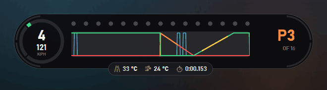
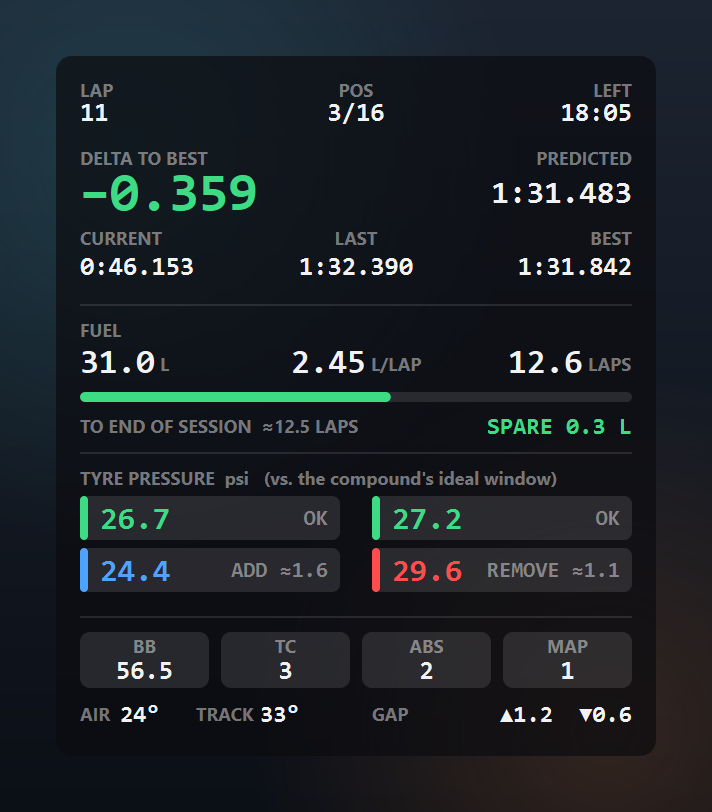
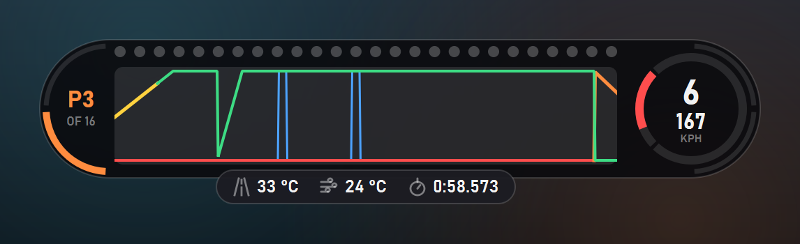
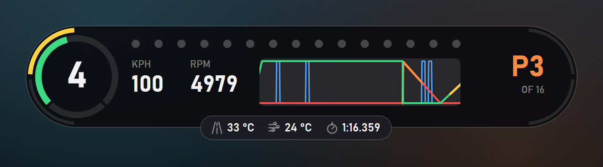
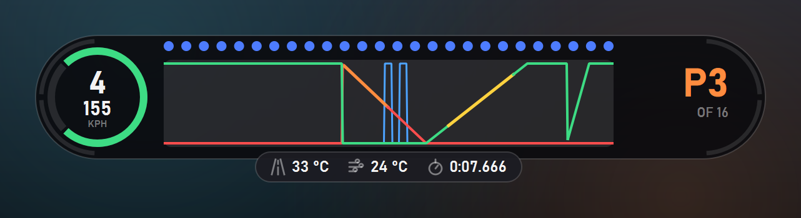
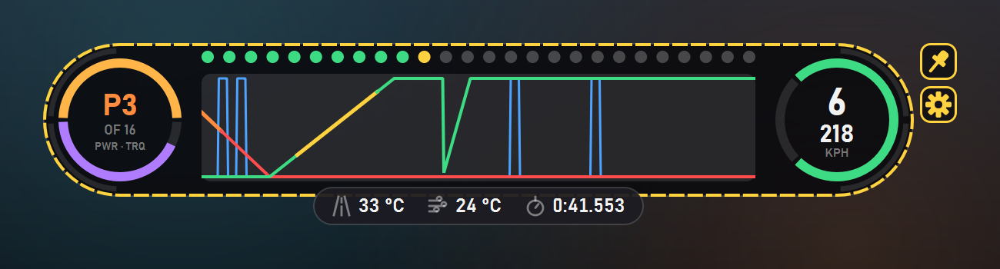
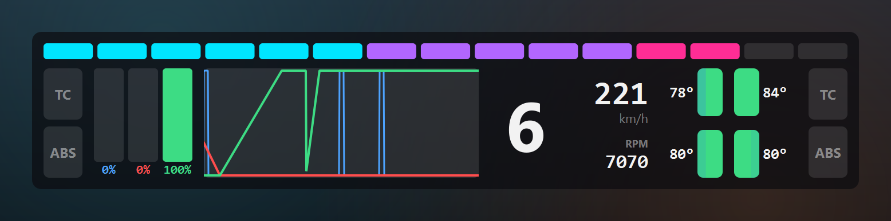
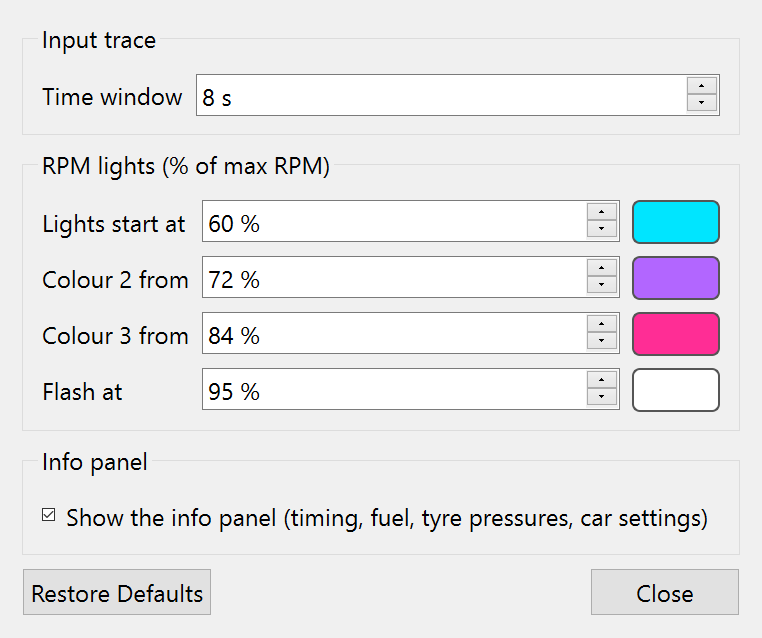

<h1 align="center">AC EVO Overlay</h1>

<p align="center">
  <strong>A lightweight, real-time telemetry overlay for Assetto Corsa EVO.</strong><br>
  A compact pill-shaped dash (gear and pedal ring, shift lights, speed, RPM, position, input trace and TC/ABS)
  plus an info panel for timing, fuel and tyre pressures, sitting on top of the game.
</p>

<p align="center">
  
  
  
  
  <a href="LICENSE"></a>
</p>

<p align="center">
  
  <br><sub>One demo lap: flat out down the straight with the shift lights, heavy braking with ABS, and TC on the exit.</sub>
</p>

---

## Features

- **Gear and pedal ring.** A ring at the right end of the pill, with the gear and speed inside it.
  Throttle fills three quarters of it in green, clockwise from the top-left, and brake fills the left
  quarter in red.
- **Shift lights.** A row of 26 dots along the top edge, with configurable colour zones and flash point. They're also
  the RPM readout.
- **Energy ring and position.** In the left end of the pill, a ring like the pedal ring surrounds
  your position ("P19 of 20"). On hybrids, the top half shows battery charge, and the bottom half live
  battery usage: purple while deploying, green while recovering energy under braking. On other cars it shows engine power (top) and torque (bottom), against the highest
  values the car has produced this session. A small label inside says which (BATT or PWR · TRQ).
- **Real-time input trace.** Scrolling throttle, brake and clutch history. The right edge is always
  your live input, and the time window (2–30 s) can be changed on the fly. The brake line turns orange
  while ABS works, and the throttle line yellow while TC cuts.
- **Side-aware TC and ABS lines.** The pill's rounded ends are thin arc lines: the upper quarter of
  each end is TC (flashes yellow) and the lower quarter ABS (flashes orange). The left end is the car's
  left wheels and the right end its right wheels, so you can see which side is slipping.
- **Track, air and lap time.** A chip under the dash with track temperature, air temperature and the
  running time of your current lap.
- **Info panel.** A second, separately placed window for race-engineer data: live delta to your best
  lap, lap times, fuel per lap and laps of fuel left, fuel needed to reach the end of the session,
  tyre pressures against the recommended pressure, brake bias, TC/ABS/engine map settings, weather,
  and gaps.
- **Stays out of the way.** Always on top and click-through, so the mouse goes straight to the game.
  Pin it in place, or unpin it and drag it anywhere.
- **Portable.** A single folder with no installer, no game files touched, and settings saved next
  to the app.

## Screenshots

<table>
  <tr>
    <td width="50%" align="center">
      
    </td>
    <td width="50%">
      <p><b>Info panel</b></p>
      <sub>
        <b>Timing:</b> live delta to your best lap (green = faster), predicted, current, last and best laps, and an INVALID tag when the lap is cut.<br><br>
        <b>Fuel:</b> litres left, average use per lap and laps remaining, plus how much fuel you need (or have spare) to reach the end of the session.<br><br>
        <b>Tyre pressures:</b> live pressure per tyre, colour-coded against the recommended pressure, with how many psi to adjust.<br><br>
        <b>Car:</b> brake bias, TC, ABS and engine map settings, air and track temperature, and gaps to the cars ahead and behind.
      </sub>
    </td>
  </tr>
</table>

<table>
  <tr>
    <td width="50%">
      
      <p align="center"><sub><b>Trail braking into a left-hander.</b> The ring's red left quarter shows the brake, and only the left ABS arc lights, where the unloaded inside wheels lock first.</sub></p>
    </td>
    <td width="50%">
      
      <p align="center"><sub><b>Corner exit.</b> The upper-left TC arc lights as the inside rear spins, and the throttle line in the trace turns yellow.</sub></p>
    </td>
  </tr>
  <tr>
    <td width="50%">
      
      <p align="center"><sub><b>Shift point.</b> Every dot flashes when RPM reaches the flash threshold.</sub></p>
    </td>
    <td width="50%">
      
      <p align="center"><sub><b>Move mode.</b> Unpin to drag the overlay anywhere, then pin to lock it in place.</sub></p>
    </td>
  </tr>
  <tr>
    <td width="50%">
      
      <p align="center"><sub><b>Your colours.</b> RPM light zones and colours are fully configurable.</sub></p>
    </td>
    <td width="50%" align="center">
      
      <p align="center"><sub><b>Settings.</b> Changes apply live and are saved automatically.</sub></p>
    </td>
  </tr>
</table>

## Getting started

### Requirements

- Windows 10 or 11
- Assetto Corsa EVO set to **borderless** or **windowed** display mode. No overlay can draw on
  top of exclusive fullscreen, and VR isn't supported.

### Portable package (no install)

Build the self-contained package (see [Development](#development)), or grab a prebuilt
`ace-overlay-<version>-win64.zip`. Then:

1. Extract the zip anywhere and open the `ace-overlay` folder.
2. Double-click **`ace-overlay.exe`**.
3. Start a session in AC EVO. The overlay shows *Waiting for Assetto Corsa EVO…* until you're on
   track, then comes alive. It can be started before or after the game.

> **Windows SmartScreen:** the app isn't code-signed, so Windows may say *"Windows protected your
> PC"* the first time. Click **More info → Run anyway**.

### From source

```bash
git clone https://github.com/blueratdota/ace-overlay.git
cd ace-overlay
python -m venv .venv
.venv\Scripts\pip install -e .
.venv\Scripts\pythonw -m ace_overlay
```

## Using the overlay

| Control | What it does |
| --- | --- |
| 📌 **Pin** (right of each window) | Click to unpin, drag the window into place, then click again to lock it. When locked, clicks pass through to the game. The HUD and the info panel each have their own pin, and positions are remembered. |
| ⚙️ **Gear** (under the HUD's pin) | Opens the settings window. |
| **Tray icon** | Right-click for *Move overlays* (unpins both windows), *Show info panel*, *Settings…* and *Quit*. |

The pin and gear fade out while you drive and light up when you hover over them.

### Settings

| Setting | Default | Description |
| --- | --- | --- |
| Input trace time window | 8 s | How much history the trace shows (2–30 s). Longer means slower scrolling. The whole trace rescales instantly. |
| Lights start at | 80 % | RPM (as % of max) where the first shift light comes on. The lights spread evenly from here to the flash point. |
| Colour 2 from / Colour 3 from | 86 % / 92 % | Where each light switches colour. Every light takes the colour of the RPM % it represents. |
| Flash at | 97 % | RPM where the whole strip flashes. |
| Colours | green / yellow / red / blue | One swatch per zone plus the flash colour. |
| Only show the HUD while driving | off | Hides the HUD in menus, the garage or pit box, replays and pause, and shows it once you leave the pit box (the pit lane counts as driving). The info panel isn't affected. While the HUD is hidden, use the tray icon for *Move overlays* (which shows it for positioning) and *Settings…*. |
| Show the info panel | on | Shows or hides the info panel (also in the tray menu). |

## How it works

AC EVO publishes live telemetry through Windows named shared memory. This is the same official
interface dashboards and tools like SimHub use. The overlay opens two of those blocks
**read-only** about 60 times a second and draws them in a transparent, always-on-top window. It
never modifies game files and never injects into the game process.

```
             ┌─▶ Local\acevo_pmf_physics   pedals, gear, speed, RPM, ABS/TC, temperatures ─┐
AC EVO ──────┤                                                                            ├──▶ ace-overlay ──▶ transparent HUD
             └─▶ Local\acevo_pmf_graphics  position, laps, fuel, tyres, ABS/TC flags ──────┘
```

### Good to know

- **Tyre wear isn't shown.** AC EVO doesn't publish it. The in-game HUD calculates it internally
  and never writes it to shared memory.
- **The TC/ABS side is inferred.** The game reports TC and ABS as single on/off flags. The overlay
  picks the side from per-wheel slip, and lights both sides when they're close or when no slip data
  is available.
- **Early access.** AC EVO is still in development and Kunos can change the telemetry layout
  between patches. If values look wrong after an update, run **`Check telemetry.bat`** (or
  `python -m ace_overlay --dump`) while driving and compare against the in-game HUD, then
  [open an issue](https://github.com/blueratdota/ace-overlay/issues).

## Development

```bash
.venv\Scripts\pip install -e .[build,dev]

.venv\Scripts\python -m ace_overlay --demo        # overlay with simulated telemetry, no game needed
.venv\Scripts\python -m ace_overlay --dump        # print live telemetry to the console
.venv\Scripts\python -m unittest discover -s tests
.venv\Scripts\python tools\screenshots.py         # regenerate the images in docs/images
.venv\Scripts\python build.py                     # build dist/ace-overlay-<version>-win64.zip
```

The demo mode drives a repeating 10-second lap, so every part of the HUD can be worked on without
the game running. `build.py` packages the app with PyInstaller, strips unused Qt modules, and zips
a portable folder with a user-facing `README.txt` and `Check telemetry.bat`.

### Project layout

```
ace_overlay/
├── shm.py        # read-only shared-memory reader, physics + graphics structs
├── overlay.py    # the HUD window, plus pin and settings buttons
├── config.py     # user settings (QSettings) and the settings window
├── demo.py       # simulated telemetry lap for development
└── app.py        # entry point: CLI flags, tray icon, portable-mode settings
packaging/        # PyInstaller launcher and files shipped in the zip
tools/            # screenshot / GIF generator
tests/            # struct layout tests pinning every documented offset
build.py          # portable package builder
```

## Acknowledgements

- Kunos Simulazioni's official
  [AC EVO shared memory documentation](https://steamcommunity.com/sharedfiles/filedetails/?id=3707421508).
- [live-telemetry-evo](https://github.com/albertowd/live-telemetry-evo) for its detailed
  field-by-field
  [shared memory reference](https://github.com/albertowd/live-telemetry-evo/blob/develop/docs/SHARED_MEMORY.md).

## License

Released under the [MIT License](LICENSE).

## Disclaimer

This is an independent community project. It isn't affiliated with or endorsed by Kunos
Simulazioni. *Assetto Corsa* is a trademark of its respective owner.
